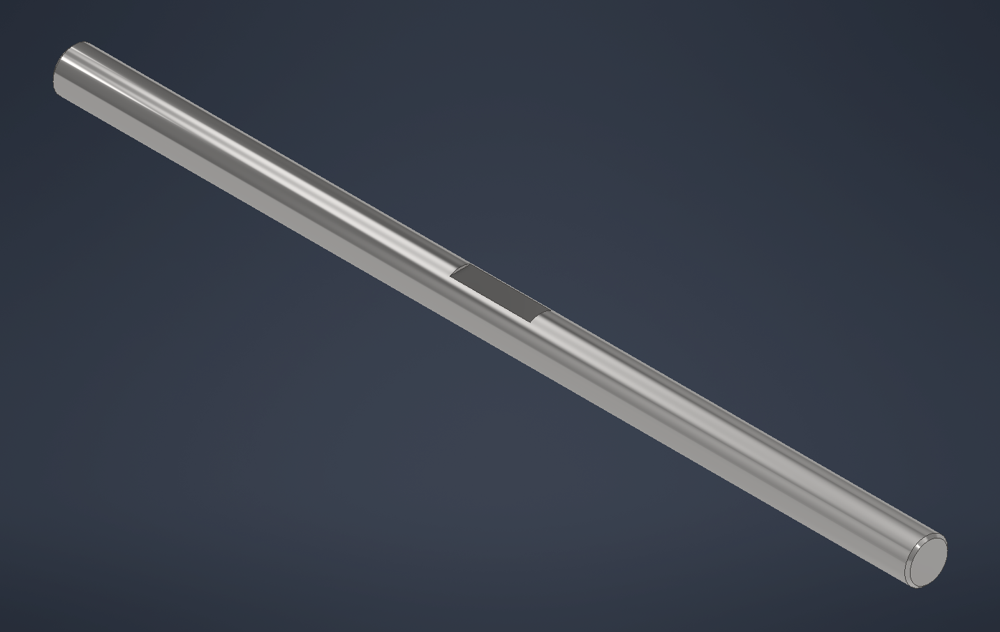

# Conveyor Drive Shaft (CNV-MEC-01)

Drive shaft for the home conveyor station's drive roller. Bought Ø8 mm steel rod, cut to 160 mm, with one filed flat for the roller hub's M3 set screw. Modeled in Autodesk Inventor as a parametric part in the `Conveyor Build` project.

## Spec

| User parameter | Value | Source |
| --- | --- | --- |
| `shaft_d` | 8.00 mm | Rod measured 7.99–8.01 mm |
| `shaft_L` | 160 mm | Conveyor layout (drive shaft) |
| `flat_depth` | 0.5 mm (7.50 mm across the flat) | Set-screw flat |
| `flat_len` | 15 mm | Roller hub length + clearance (placeholder until the roller is modeled) |
| `flat_x` | 80 mm | Flat centre from the motor end (placeholder) |
| `chamfer` | 0.5 × 45°, both ends | Deburred cut ends |

Material: Steel (7.85 g/cm³). Features: `Rod` → `FlatStartPlane` → `SetScrewFlat` → `EndChamfers`. All sketches fully constrained and driven by the user parameters.

## Check

Inventor's mass properties against a hand calculation:

V = πr²L − V_flat − 2V_chamfer = 8042.48 − 19.62 − 6.02 = 8016.84 mm³

- Flat: circular segment (r = 4 mm, h = 0.5 mm), area 1.308 mm² × 15 mm = 19.62 mm³
- Each chamfer: π·c²·(r − c/3) = 3.01 mm³, with c = 0.5 mm

| Quantity | Inventor | Hand calc |
| --- | --- | --- |
| Volume | 8016.835 mm³ | 8016.835 mm³ |
| Mass | 0.063 kg | 0.0629 kg |
| Centre of gravity, x | 80.000 mm | 80.000 mm (flat centred on the shaft) |
| I about the axis | 0.502 kg·mm² | 0.503 kg·mm² |

The exact volume match confirms the flat depth, flat length and both chamfers.

## Files

- `CNV-MEC-01_Drive-Shaft.ipt`: Inventor part
- `3d-view.png`: iso view (Steel - Polished)
- `mass-properties.png`: iProperties, Physical tab
