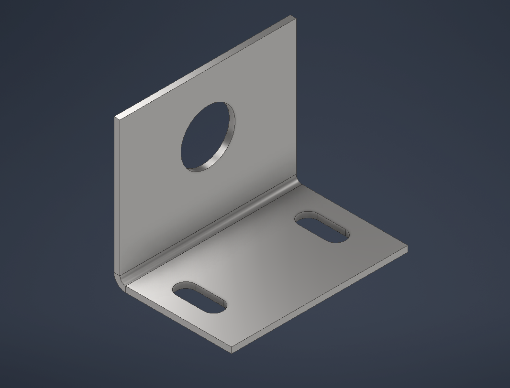
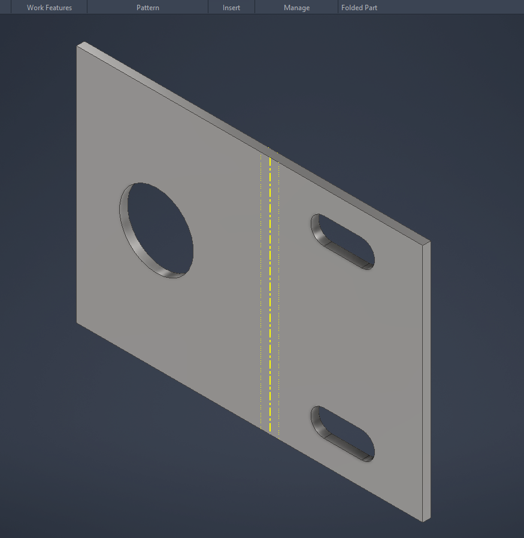

# Photo-Eye Bracket (Sheet Metal)

L-bracket that mounts a photo-eye to the conveyor side rail. Modeled in Autodesk Inventor as a sheet-metal part, with a flat pattern.

## Spec
| Feature | Value |
| --- | --- |
| Material / thickness | Mild steel, 2.0 mm |
| Bend | 90°, inside radius 2.0 mm |
| Base flange | 60 × 40 mm (outside) |
| Upright flange | 60 × 50 mm (outside) |
| Mounting slots | 2 × 6.6 mm wide (M6 clearance), 16 mm overall, 35 mm apart, running toward the bend for adjustment |
| Sensor hole | Ø18.5 mm, centered on the width, 30 mm up from the bottom face. Placeholder for an M18 barrel sensor; set from the sensor datasheet once the photo-eye is chosen |

All sketches are fully constrained. The slots are mirrored about a centerline, so they stay symmetric if the dimensions change.

## Flat pattern check
Unfold rule: Default_KFactor, K = 0.44.

BA = (π/2)(R + K·t) = (π/2)(2 + 0.44 × 2) = 4.524 mm

BD = 2(R + t) − BA = 8 − 4.524 = 3.476 mm

L_flat = 40 + 50 − 3.476 = 86.52 mm

Inventor's flat pattern measured **86.52 mm**, matching the hand calculation.

## Files
- `Photo_Eye_L_Bracket.ipt`: Inventor part (folded model + flat pattern).
