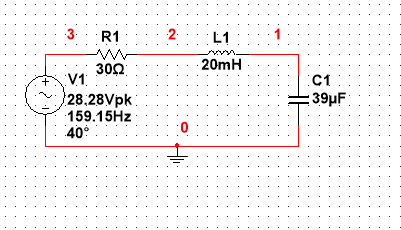
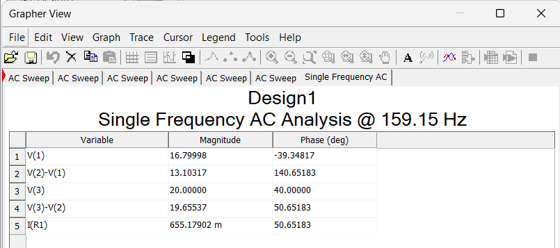
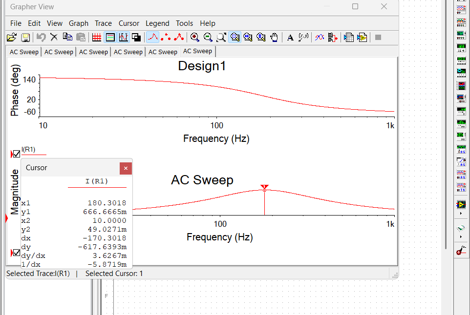
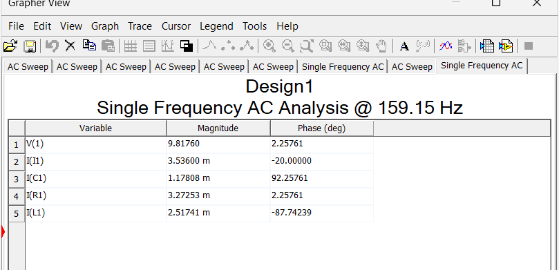
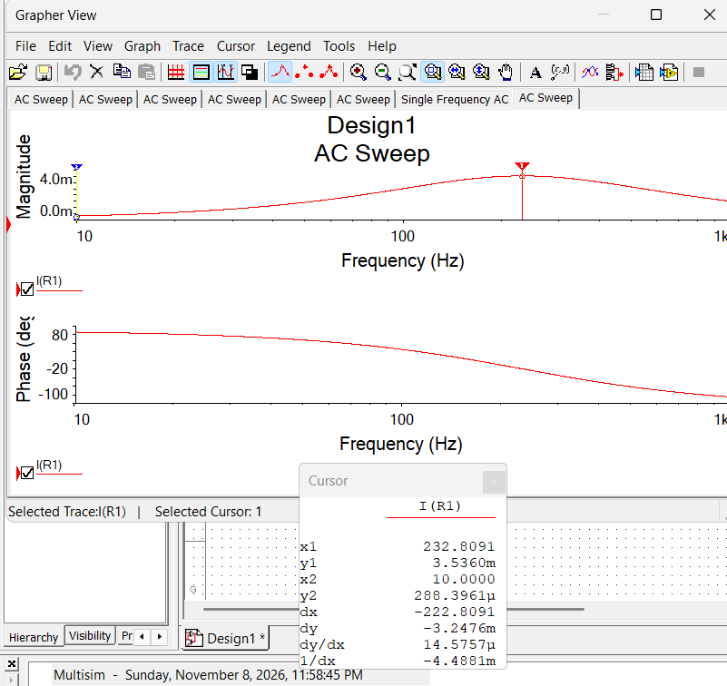

# Week 1 Multisim Checks

Hand calculation vs NI Multisim simulation, week of Nov 9, 2026.

All values are RMS phasors. Hand calculations were done first; the Multisim column is filled in from the simulation.

## Series RLC: Boylestad Prob. 15.29 (Fig. 15.101)
R = 30 Ω, L = 20 mH, C = 39 µF, e = √2(20) sin(1000t + 40°) V → E = 20 V ∠40°, f = 159.15 Hz

| Quantity | Hand | Multisim | % error |
| --- | --- | --- | --- |
| Zₜ | 30.53 Ω ∠−10.65° | 30.53 Ω ∠−10.65° (E/I) | 0.01 % |
| I | 0.655 A ∠50.65° | 0.6552 A ∠50.65° | 0.00 % |
| Vᵣ | 19.66 V ∠50.65° | 19.655 V ∠50.65° | 0.02 % |
| Vₗ | 13.10 V ∠140.65° | 13.103 V ∠140.65° | 0.02 % |
| V꜀ | 16.80 V ∠−39.35° | 16.800 V ∠−39.35° | 0.00 % |
| P | 12.88 W | 12.88 W (I²R) | 0.02 % |
| f₀ = 1/(2π√(LC)) | 180.21 Hz (current peak in AC sweep) | 180.30 Hz | 0.05 % (sweep resolution) |
| I at resonance = E/R | 0.6667 A | 0.6667 A | 0.00 % |

**Single Frequency AC analysis at 159.15 Hz:** node 3 is the source (+), so Vᵣ = V(3) − V(2), Vₗ = V(2) − V(1), V꜀ = V(1). All errors are below 0.03 %, which is rounding in the hand calculation.

**AC sweep, 10 Hz–1 kHz:** the current peaks at f₀, where Xₗ = X꜀ and Zₜ = R. Phase runs from +130° (capacitive, I leads E) through 40° at resonance (in phase with E) to −50° (inductive, I lags E).

## Parallel RLC: Boylestad Prob. 16.13 (Fig. 16.71)
R = 3 kΩ ∥ L = 3.9 H ∥ C = 0.12 µF, iₛ = 5 sin(1000t − 20°) mA → Iₛ = 3.536 mA ∠−20°, f = 159.15 Hz

| Quantity | Hand | Multisim | % error |
| --- | --- | --- | --- |
| Zₜ | 2777 Ω ∠22.26° | 2776.5 Ω ∠22.26° (V/Iₛ) | 0.01 % |
| V | 9.816 V ∠2.26° | 9.8176 V ∠2.26° | 0.02 % |
| Iᵣ | 3.272 mA ∠2.26° | 3.2725 mA ∠2.26° | 0.02 % |
| Iₗ | 2.517 mA ∠−87.74° | 2.5174 mA ∠−87.74° | 0.02 % |
| I꜀ | 1.178 mA ∠92.26° | 1.1781 mA ∠92.26° | 0.01 % |
| f₀ = 1/(2π√(LC)) | 232.65 Hz (V and Iᵣ peak; Zₜ maximum) | 232.81 Hz | 0.07 % (sweep resolution) |
| Iᵣ at resonance = Iₛ | 3.536 mA | 3.536 mA | 0.00 % |

**Single Frequency AC analysis at 159.15 Hz:** node 1 is the top node, so V = V(1). Iₗ lags V by 90° and I꜀ leads V by 90°, as expected. All errors are below 0.03 %.

**AC sweep, 10 Hz–1 kHz (Iᵣ = V/R):** at f₀ the L and C branch currents cancel, so all of Iₛ flows through R and Iᵣ = Iₛ. Phase runs from about +70° (inductive branch dominates) through −20° at resonance (in phase with Iₛ) to about −110° (capacitive).

