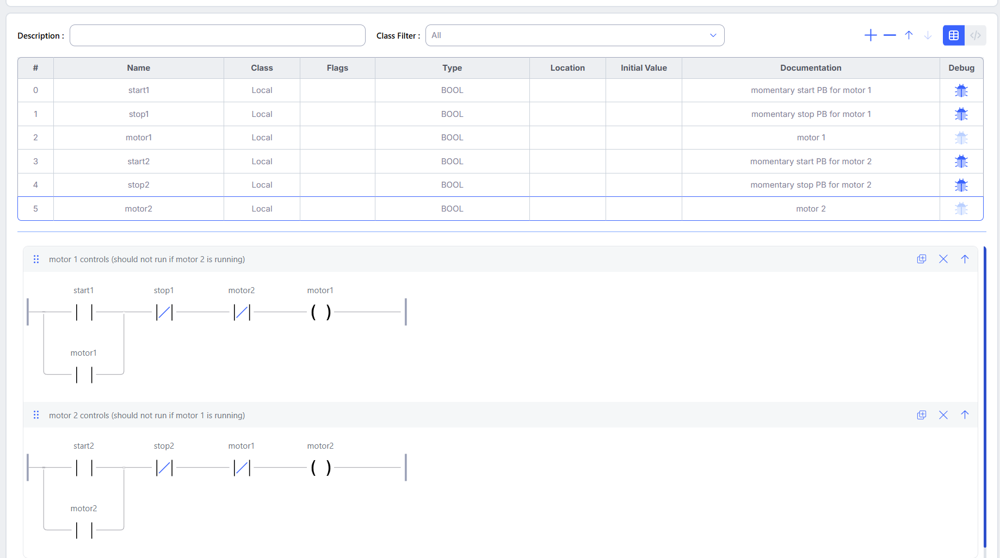
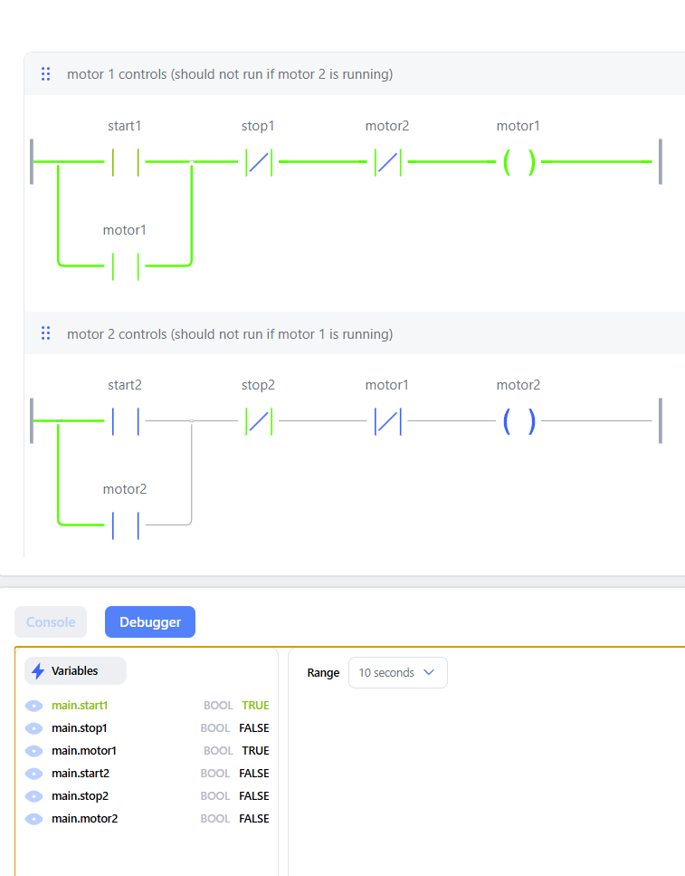
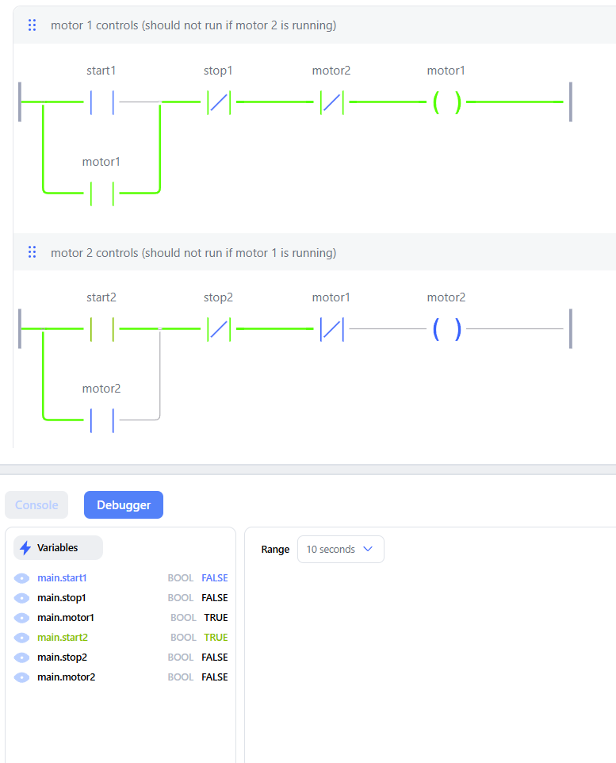
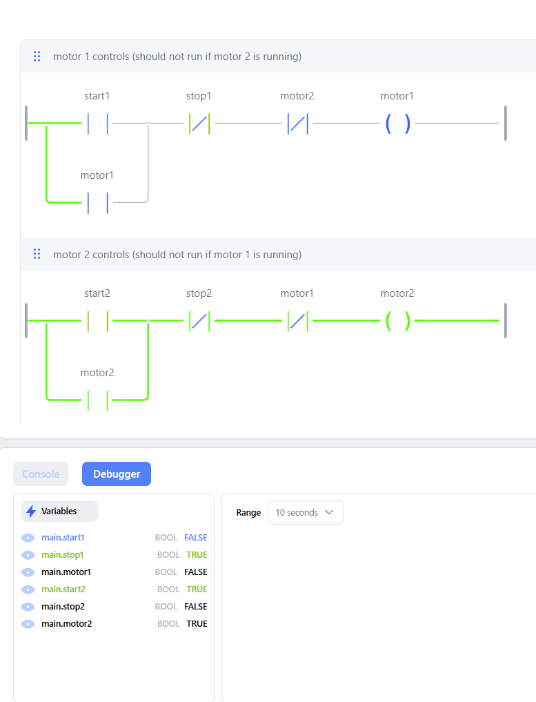
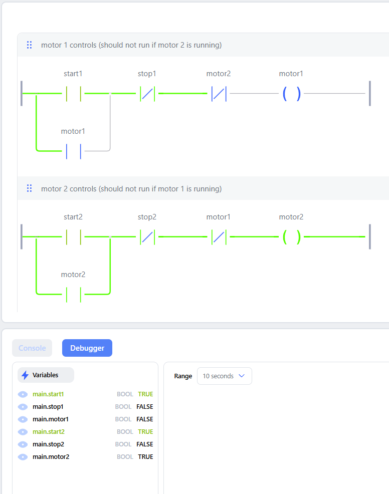
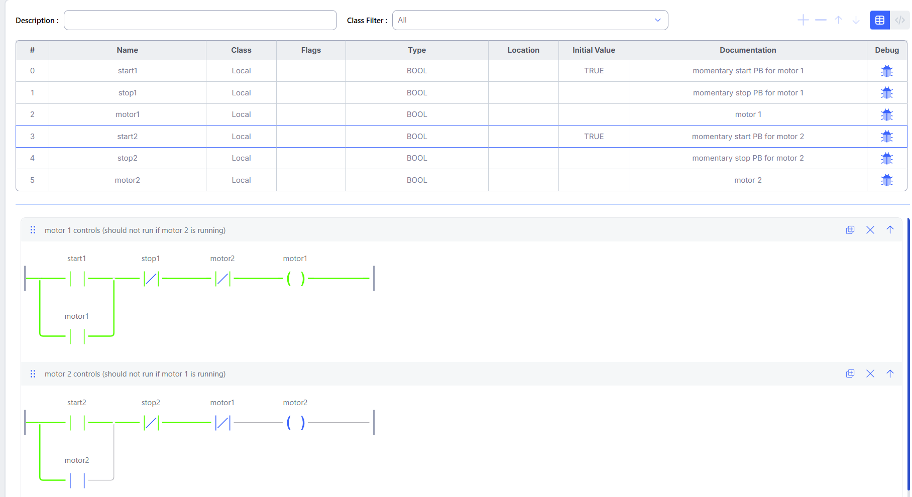

# Two-Motor Interlock

Two motors, each with its own start/stop. Only one can run at a time: each motor's run bit blocks the other motor's rung. Built in OpenPLC Editor and tested in the debugger.

## I/O
| Tag | Type | Location | Description |
| --- | --- | --- | --- |
| start1 | BOOL | — | Momentary start pushbutton, motor 1 |
| stop1 | BOOL | — | Momentary stop pushbutton, motor 1 |
| motor1 | BOOL | — | Motor 1 running |
| start2 | BOOL | — | Momentary start pushbutton, motor 2 |
| stop2 | BOOL | — | Momentary stop pushbutton, motor 2 |
| motor2 | BOOL | — | Motor 2 running |

## Logic
- motor1 = (start1 OR motor1) AND NOT stop1 AND NOT motor2
- motor2 = (start2 OR motor2) AND NOT stop2 AND NOT motor1

Each rung is a seal-in with one extra NC contact: the other motor's run bit. That contact is the interlock.

## Test
| # | Action | Expected | Result |
| --- | --- | --- | --- |
| 1 | Press start1 | motor1 = 1, motor2 = 0 | Pass |
| 2 | With motor1 running, press start2 | motor2 stays 0 | Pass |
| 3 | Press stop1, then start2 | motor1 = 0, motor2 = 1 | Pass |
| 4 | With motor2 running, press start1 | motor1 stays 0 | Pass |
| 5 | From all-off, start1 and start2 TRUE on the same scan | One motor only | Pass: motor1 wins |

**Test 1: start1 pressed.** motor1 = TRUE and seals in; motor2 = FALSE.

**Test 2: start2 pressed while motor1 runs.** The NC motor1 contact in rung 2 is open, so motor2 stays FALSE.

**Test 3: stop1 pressed, then start2.** motor1 drops, the interlock in rung 2 closes, and motor2 = TRUE.

**Test 4: start1 pressed while motor2 runs.** The NC motor2 contact in rung 1 is open, so motor1 stays FALSE.

**Test 5: start1 and start2 TRUE on the first scan.** Both starts were set to Initial Value = TRUE, so they are true together on the first scan. motor1 = TRUE, motor2 = FALSE.

**Why motor1 wins:** the PLC evaluates rungs top to bottom, and an internal bit written in one rung is already updated when the next rung reads it.
1. Rung 1 runs first. motor2 is still FALSE, so its NC contact is closed and motor1 turns on.
2. Rung 2 runs next. motor1 is now TRUE in the same scan, so its NC contact is open and motor2 stays off.

The top rung gets priority. For a defined result when both buttons are pressed, choose the rung order on purpose. To start neither motor in that case, add an NC contact of the other start button to each rung.

## Field-wiring note
This is a software interlock only. On real motor starters, such as forward/reverse contactors, also wire an electrical interlock: each contactor's NC auxiliary contact in series with the other's coil. Add a mechanical interlock where the contactors support one. That way a welded contact or a PLC fault cannot energize both.

## Files
- `interlock-project.zip`: OpenPLC Editor project. Unzip it and open the `motor interlock` folder in OpenPLC Editor. The ladder program is `pous/programs/main.ld`.
