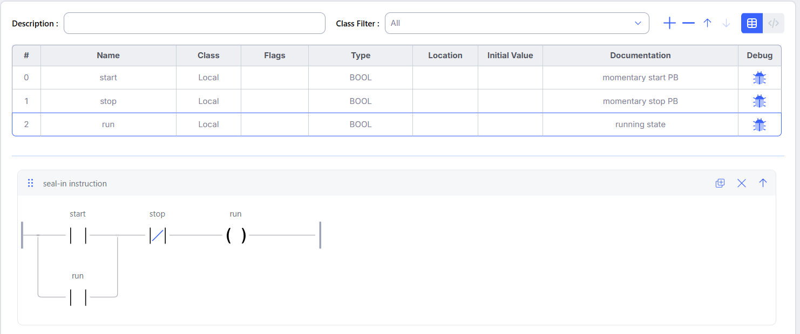
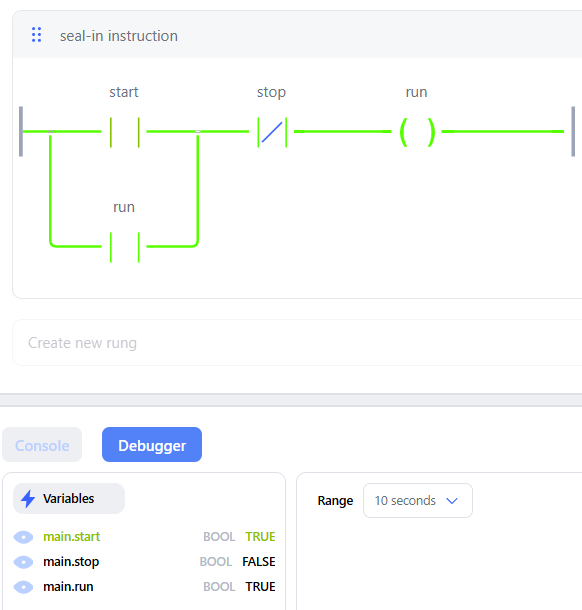
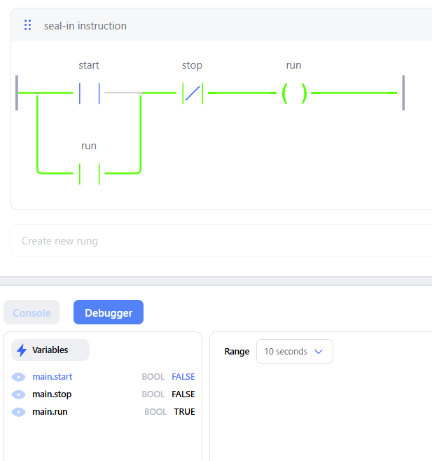
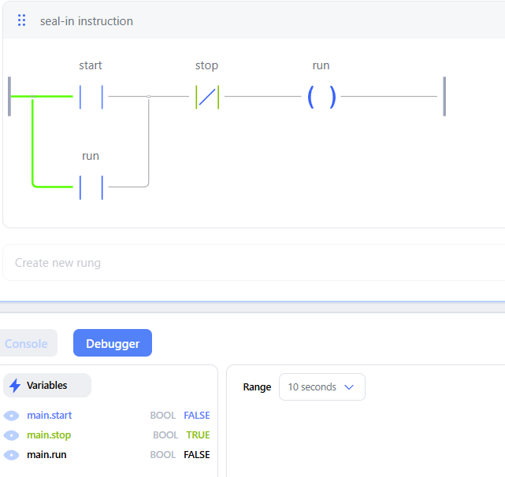

# Seal-In (Start/Stop Latch)

Momentary start latches the run output; stop drops it. Built in OpenPLC Editor and tested in the debugger.

## I/O
| Tag | Type | Location | Description |
| --- | --- | --- | --- |
| start | BOOL | — | Momentary start pushbutton |
| stop | BOOL | — | Momentary stop pushbutton |
| run | BOOL | — | Running state (seal-in bit) |

## Logic
run = (start OR run) AND NOT stop. The `run` contact in parallel with `start` holds the coil on after start is released.

## Test
| Step | Action | Expected | Result |
| --- | --- | --- | --- |
| 1 | Press start | run = 1 | Pass |
| 2 | Release start | run stays 1 | Pass |
| 3 | Press stop | run = 0 | Pass |
| 4 | Hold stop, press start | run stays 0 (stop wins) | Pending |

**Step 1: start pressed.** start = TRUE, run = TRUE.

**Step 2: start released, seal-in holds.** start = FALSE, run = TRUE through the parallel `run` contact.

**Step 3: stop pressed.** stop = TRUE opens the NC contact, run = FALSE.

## Field-wiring note
In simulation, stop is a momentary NO input, so the logic uses an NC contact.
On real hardware, wire the stop button NC and use a NO contact in logic.
That way a broken stop wire stops the motor instead of leaving it unstoppable.
