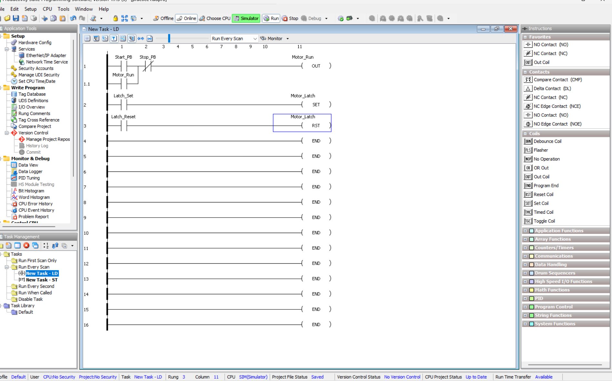
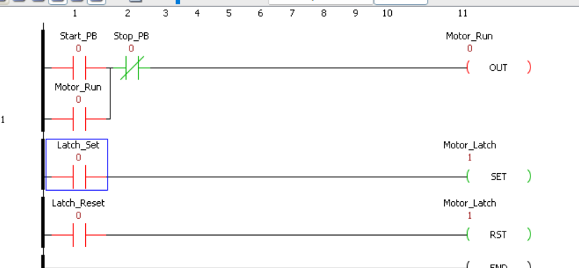

# SET/RESET vs Seal-In (Power-Loss Comparison)

Two latch methods compared after a power loss. Built in AutomationDirect Productivity Suite 4.7.3 (P1000 CPU) and tested in its built-in simulator. This is the first exercise on the Productivity platform.

## Tags
All internal Booleans (no I/O modules configured).

| Tag | Description | Retentive |
| --- | --- | --- |
| Start_PB | Momentary start | No |
| Stop_PB | Momentary stop | No |
| Motor_Run | Seal-in output | No |
| Latch_Set | Set input | No |
| Latch_Reset | Reset input | No |
| Motor_Latch | SET/RESET output | No (test 7), Yes (test 8) |

## Logic
| Rung | Logic |
| --- | --- |
| 1 / 1.1 | (Start_PB OR Motor_Run) AND NOT Stop_PB → OUT Motor_Run |
| 2 | Latch_Set → SET Motor_Latch |
| 3 | Latch_Reset → RST Motor_Latch |

The seal-in branch (rung 1.1) rejoins between Start_PB and Stop_PB, so Stop always breaks the seal. SET/RST write the bit only when their rung is true; the bit holds its value otherwise.

## Tests
Bits toggled with Ctrl+T on the contacts while online in Monitor.

| # | Action | Expected | Result |
| --- | --- | --- | --- |
| 1 | Start_PB on, then off | Motor_Run = 1, stays 1 | Pass |
| 2 | Stop_PB on, then off | Motor_Run = 0 | Pass |
| 3 | Latch_Set on, then off | Motor_Latch = 1, stays 1 | Pass |
| 4 | Latch_Reset on, then off | Motor_Latch = 0 | Pass |
| 5 | Stop_PB and Start_PB both on | Motor_Run = 0 (stop wins) | Pass |
| 6 | Latch_Set and Latch_Reset both on | Motor_Latch = 0 (RST is the later rung) | Pass |
| 7 | Both outputs on, Motor_Latch non-retentive; CPU stop → run | Motor_Run = 0, Motor_Latch = 0 | Pass |
| 8 | Both outputs on, Motor_Latch retentive; CPU stop → run | Motor_Run = 0, Motor_Latch = 1 | Pass |

**After test 8:** Motor_Run came back 0; the retentive Motor_Latch came back 1.

## Conclusion
Seal-in is safer for a motor. After power came back, Motor_Run stayed off until Start was pressed again. The retentive Motor_Latch came back on by itself, so a motor on it could start while someone is working on the machine.

Test 6: when Set and Reset are both on, Reset wins because it's on the later rung.

## Notes
- Stop is an NC contact because the simulated stop is a momentary NO bit. On real hardware, wire stop NC and use a NO contact in logic.
- Stop → Run in the simulator was used as the power-loss stand-in.

## Files
- Productivity Suite project (`practice1.adpro`): to be added.
